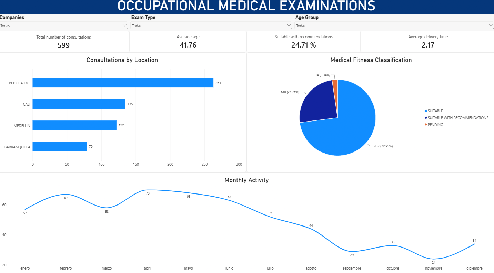

<!-- MAIN TITLE -->
<h1 align="center">🩺 Occupational Medical Examinations Analysis</h1>

  An interactive <b>Power BI dashboard</b> for monitoring occupational medical examinations across locations, tracking <b>medical fitness outcomes</b>, and exploring <b>monthly consultation trends</b>. 
  The report helps occupational health and operations teams identify patterns, monitor service performance, and support <b>data-driven decisions</b>.

---

## 🧭 1. Introduction

Occupational medical examinations play an important role in workforce health monitoring and occupational health management. A consolidated view of examination activity can help teams understand how services are distributed across locations, track assessment outcomes, and monitor demand over time.

This project presents an interactive Power BI report that brings together **consultation volumes**, **age-related indicators**, **fitness classifications**, and **service delivery metrics** in a single dashboard.

---

## 🎯 2. Project Objective

To develop a clear, interactive reporting tool that helps teams:

- Monitor the **total number of occupational medical consultations**.
- Compare examination volumes across **headquarters / locations**.
- Analyze the distribution of **medical fitness (aptitude) classifications**.
- Identify **monthly consultation trends** and changes in activity.
- Explore results by **company**, **exam type**, and **age group**.
- Track high-level indicators, including **average age** and **average delivery time**.

---

## 🧪 3. What Was Done

### ✔ KPI Monitoring

Created an executive dashboard view with four key indicators:

1. **Total consultations** — overall examination volume.
2. **Average age** — average age of the population represented in the report.
3. **Suitable with recommendations (%)** — share of examinations in this classification.
4. **Average delivery time** — service turnaround indicator as displayed in the report.

### ✔ Analytical Visualizations

Designed complementary visuals to answer operational questions:

1. **Horizontal Bar Chart — Consultations by headquarters**  
   Compares examination activity across Bogotá D.C., Cali, Medellín, and Barranquilla.
2. **Pie Chart — Medical fitness classification**  
   Shows the distribution of *Suitable*, *Suitable with recommendations*, and *Pending* outcomes.
3. **Line Chart — Monthly consultations**  
   Tracks examination volumes from January through December.
4. **Interactive Filters**  
   Enables exploration by company, exam type, and age group.

---

## 🛠️ 4. Tools & Technologies Used

- **Microsoft Power BI Desktop** — interactive dashboard development.
- **Business Intelligence reporting** — KPI monitoring and operational analysis.
- **Data visualization** — comparative bar chart, distribution chart, and monthly trend chart.
- **Interactive filtering** — exploration by company, examination type, and age segment.

---

## 📊 5. Key Results

### ✔ Executive Indicators

| Metric | Dashboard Result |
|---|---:|
| Total medical consultations | **599** |
| Average age | **41.76** |
| Suitable with recommendations | **24.71%** |
| Average delivery time | **2.17** |

*Note: The unit of measurement for average delivery time is not specified in the provided dashboard screenshot.*

### ✔ Consultations by Location

| Headquarters | Consultations | Share of Total |
|---|---:|---:|
| Bogotá D.C. | **263** | **43.91%** |
| Cali | **135** | **22.54%** |
| Medellín | **122** | **20.37%** |
| Barranquilla | **79** | **13.19%** |

Bogotá D.C. records the highest number of consultations, representing approximately **44%** of the total.

### ✔ Medical Fitness Classification

- **Suitable:** 437 consultations (**72.95%**).
- **Suitable with recommendations:** 148 consultations (**24.71%**).
- **Pending:** 14 consultations (**2.34%**).

These categories describe the classifications shown in the dashboard; they do not, by themselves, establish any individual medical diagnosis.

### ✔ Monthly Activity

- **April** recorded the highest consultation volume (**70**).
- **May** and **February** followed with **68** and **67** consultations.
- **November** recorded the lowest volume (**24**).

The monthly trend supports further investigation of demand patterns and operational planning needs.

---

## 📊 6. Dashboard

The Power BI report combines executive KPIs, location comparisons, examination outcomes, monthly trends, and interactive filters in one view.

  

### Dashboard Features

- **Company, exam type, and age group filters** for targeted exploration.
- **KPI cards** for consultation volume, average age, classification rate, and delivery time.
- **Location comparison** to understand how workload is distributed.
- **Fitness classification breakdown** to monitor assessment outcomes.
- **Monthly activity trend** to examine consultation patterns.

**[Open the Power BI project (.pbix)](Occupational_Medical_Examinations.pbix)**

*Open the `.pbix` file in Microsoft Power BI Desktop to explore the interactive report.*

---

## 🔍 7. Insights & Conclusions

- **Location concentration:** Bogotá D.C. accounts for the largest share of examinations, indicating where a significant portion of activity is recorded.
- **Outcome monitoring:** Most examinations are classified as *Suitable*; the *Suitable with recommendations* and *Pending* segments merit ongoing operational follow-up under applicable processes.
- **Demand variability:** Monthly consultation counts fluctuate, suggesting value in tracking demand for capacity and scheduling decisions.
- **Reporting efficiency:** A centralized, filterable dashboard makes it easier to compare operational indicators and identify areas for further analysis.

**Strategic takeaway:** The dashboard turns occupational medical examination records into an accessible operational overview, supporting performance monitoring and informed workforce health management.
